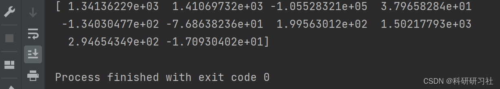
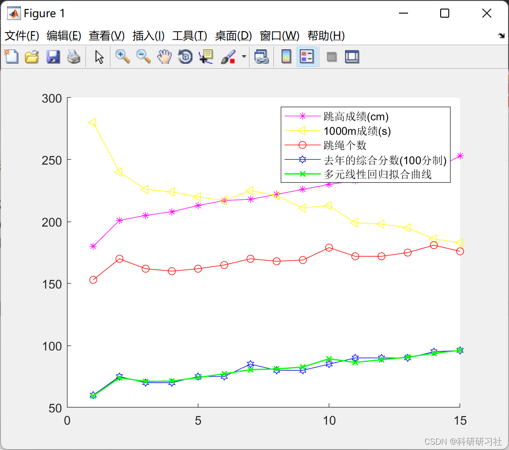
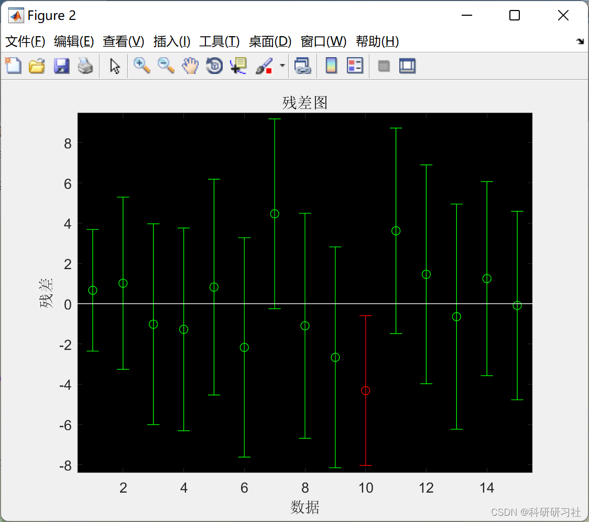
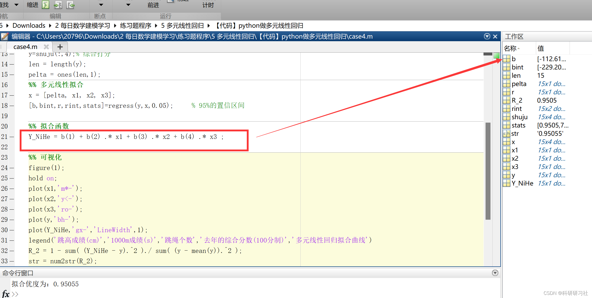
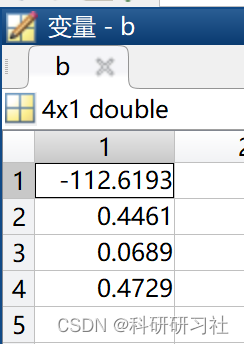
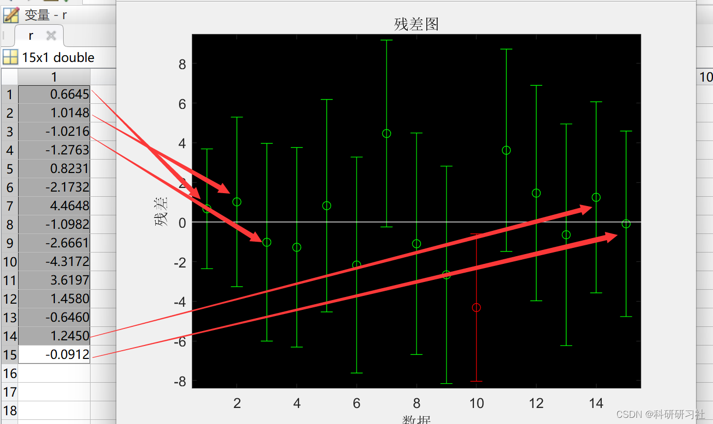

# Multivariate Linear Regression (Python & Matlab Code Implementation)

​  
1. Overview: The study of the univariate linear regression model involves investigating the quantitative relationship between a dependent variable and one independent variable, exhibiting a linear trend. In actual problems, It is often encountered that a single independent variable has multiple dependent variables. This requires the establishment of a multivariate linear regression model.
I describe it with a formula:
① Among them, x1 , x2 , . . . , Xn represent 1st independent variable, 2nd independent variable ...,  Nth independent variable. ②f ( x1 , x2 , . . . , xn represents the dependent variable that is linearly combined by these independent variables. ③α1 ,  α2 ,  . . . ,  αn represent the coefficients to be fitted. ④β represents the constants to be fitted. In real-life situations, We often encounter problems with linear relationships between multiple variables. At this point, multivariate linear regression should be utilized. Multivariate linear regression is a generalization of univariate regression. It is very widely used in practical applications. This article will demonstrate how to use multivariate linear regression to solve practical problems using both Python code and MATLAB code.
2 Example 12.1 This example is derived from the 2022 Ningxia Cup for University Students' Employment Analysis.
Employment issues for college students have always been a focal point of societal concern. According to a press conference held by the Ministry of Education, the number of college graduates in 2022 reached 10.76 million, marking the first time it has exceeded 10 million and setting new historical records both in scale and increase. However, due to factors such as market conditions and the pandemic, there is significant pressure on employment. What are the characteristics and trends of college students' employment? Among the many students seeking employment, what factors determine which students secure jobs with varying salaries in the competitive environment? These factors may include academic performance at university, personal skills, proximity to industrial centers, degree of specialization, and market conditions in specific industries. It is reported that India hosts 6,214 engineering and technology institutions, with approximately 2.9 million students enrolled.An average of 1.5 million students obtain engineering degrees each year, but due to a lack of skills required for technical work, less than 20% of these students find employment in their core fields. The attached document (https: / /www.datafountain.cn/datasets/4955) provides a table showing the salary levels and various factors affecting employment among graduates from engineering-related programs in India. Based on the data from the attachment combined with other research findings:
Analyze the main factors affecting the salary of engineering major graduates in universities.。2.2 PythonCode implementation from sklearn import linear_model\nimport pandas as pd\n# Some features can be removed based on relevance.\nshuju=pd.read_csv('Data.csv')\nx =shuju[["10percentage","12percentage","CollegeTier","MechanicalEngg","ElectricalEngg","TelecomEngg","CivilEngg","collegeGPA","Logical","GraduationYear"]]\ny =shuju["Salary"]\nregr = linear_model.LinearRegression() #Establishing the model\nregr.fit(x, y) # Training\n# Retrieve the coefficients of regression。\nprint(regr.coef_)\n  
2.3 The results then obtain the relationship between salary and other independent variables: Here, the coefficients obtained from each independent variable are displayed:
Editor
3 Example 2.1 This example uses data from Example 1, but we switch to a more advanced method of solving it.
3.2 PythonCode# ====Import relevant libraries===========\nimport numpy as np\nimport pandas as pd\nimport statsmodels.api as sm  # Implementing Multivariate Linear Regression\n\n# =====Next is data preprocessing.===========\nfile = r'shuju.csv'\ndata = pd.read_csv(file)\ndata.columns = ["Salary","10percentage","12percentage","CollegeTier","MechanicalEngg","ElectricalEngg","TelecomEngg","CivilEngg","collegeGPA","Logical","GraduationYear"]\n\n# ====Start generating a multivariate linear model=====\nx = sm.add_constant(data.iloc[:, 1:])  # Generates independent variablesx1~x9,PythonFrom0Starting the index, andMatlabDifferent, MatlabFrom1Start indexing\ny = data["Salary"]  # Generate dependent variable\nmodel = sm.OLS(y, x)  # Generation model\nresult = model.fit()  # Model fitting\nresult.summary()  # Model description\nprint(result.summary())\n  
Result:
OLS Regression Results                            \n==============================================================================\nDep. Variable:                 Salary   R-squared:                       0.084\nModel:                            OLS   Adj. R-squared:                  0.080\nMethod:                 Least Squares   F-statistic:                     27.21\nDate:                Wed, 21 Sep 2022   Prob (F-statistic):           2.90e-50\nTime:                        20:17:27   Log-Likelihood:                -40896.\nNo. Observations:                2998   AIC:                         8.181e+04\nDf Residuals:                    2987   BIC:                         8.188e+04\nDf Model:                          10                                         \nCovariance Type:            nonrobust                                         \n==================================================================================\n                     coef    std err          t      P>|t|      [0.025      0.975]\n----------------------------------------------------------------------------------\nconst             8.2e+04   2.12e+05      0.387      0.699   -3.34e+05    4.98e+05\n10percentage    1341.3623    503.139      2.666      0.008     354.828    2327.897\n12percentage    1410.6973    446.494      3.160      0.002     535.231    2286.164\nCollegeTier    -1.055e+05   1.44e+04     -7.309      0.000   -1.34e+05   -7.72e+04\nMechanicalEngg    37.9658     37.902      1.002      0.317     -36.350     112.282\nElectricalEngg  -134.0305     43.477     -3.083      0.002    -219.278     -48.783\nTelecomEngg      -76.8638     36.165     -2.125      0.034    -147.775      -5.952\nCivilEngg        199.5630    116.302      1.716      0.086     -28.478     427.604\ncollegeGPA      1502.1779    494.583      3.037      0.002     532.420    2471.936\nLogical          294.6543     45.724      6.444      0.000     205.000     384.309\nGraduationYear   -17.0930    101.498     -0.168      0.866    -216.107     181.921\n==============================================================================\nOmnibus:                     4088.757   Durbin-Watson:                   2.029\nProb(Omnibus):                  0.000   Jarque-Bera (JB):          1454349.913\nSkew:                           7.577   Prob(JB):                         0.00\nKurtosis:                     109.831   Cond. No.                     1.18e+05\n==============================================================================\n\nNotes:\n[1] Standard Errors assume that the covariance matrix of the errors is correctly specified.\n[2] The condition number is large, 1.18e+05. This might indicate that there are\nstrong multicollinearity or other numerical problems.\n  
In this result, we mainly look at the columns "coef", "t", and "P > |t|". The "coef" column represents the regression coefficients as mentioned earlier, while the "const" value is the constant term of the regression model. Therefore, the regression model we obtained is: y = 320.640948 + 1341.3623x1 + 1410.6973x2 - 1.055e+05x3 - 37.9658x4 - 134.0305x5 - 76.8638x6 + 199.5630x7 - 1502.1779x8 + 294.6543x9 - 17.0930x10.The columns "t" and "P > |t|" are equivalent; one can be chosen based on the application. They primarily serve to determine the linear significant relationship between each independent variable and y, which will be discussed later. From the graph, it is also evident that the Prob (F-statistic) is 4.21e-20, a value commonly used as the P-value, which is close to zero, indicating that our multiple linear equation is significant, meaning there is a significant linear relationship between y and x1, x2, ..., x9. The R-squared value of 0.992 also suggests that this linear relationship is quite significant.
The multivariate linear equation has been theoretically solved, and the results are quite good. We can now use it for prediction, but we still need to delve deeper into this topic.
Here is the Python code:
\n# ====Import relevant libraries===========\nimport numpy as np\nimport pandas as pd\nimport statsmodels.api as sm  # Implementing Multivariate Linear Regression\n\n# =====Next is data preprocessing.===========\nfile = r'shuju.csv'\ndata = pd.read_csv(file)\ndata.columns = ["Salary","10percentage","12percentage","CollegeTier","MechanicalEngg","ElectricalEngg","TelecomEngg","CivilEngg","collegeGPA","Logical","GraduationYear"]\n\n# ====Start generating a multivariate linear model=====\nx = sm.add_constant(data.iloc[:, 1:])  # Generates independent variablesx1~x9,PythonFrom0Starting the index, andMatlabDifferent, MatlabFrom1Start indexing\ny = data["Salary"]  # Generate dependent variable\nmodel = sm.OLS(y, x)  # Generation model\nresult = model.fit()  # Model fitting\nresult.summary()  # Model Description\nprint(result.summary())\n\n'''\nyWithx1, x2, ..., x9There is a significant linear relationship here, which needs to be noted.x1Tox9This9A variable is considered as a whole., \nyThere is a significant linear relationship with this overall, but it does not represent...yThere is a significant linear relationship with each of the independent variables., \nWe are here to identify those that...yRemove the independent variables that do not show a significant linear relationship.,The function below serves this purpose.。\n\n'''\n\n\n# =====IdentifyyWhich variables have a significant relationship with=============\ndef looper(limit):  # limitGenerally, take0.05\n    cols = ["10percentage","12percentage","CollegeTier","MechanicalEngg","ElectricalEngg","TelecomEngg","CivilEngg","collegeGPA","Logical","GraduationYear"]\n    for i in range(len(cols)):\n        data1 = data[cols]\n        x = sm.add_constant(data1)  # Generates independent variables\n        y = data['Salary']  # Generate dependent variable\n        model = sm.OLS(y, x)  # Generation model\n        result = model.fit()  # Model fitting\n        pvalues = result.pvalues  # All results in the outputPValue\n        pvalues.drop('const', inplace=True)  # DeleteconstThis column\n        pmax = max(pvalues)  # Select the largestPValue\n        if pmax > limit:\n            ind = pvalues.idxmax()  # Find the maximumPValueindex\n            cols.remove(ind)  # ThisindexFromcolsRemoved\n        else:\n            return result\n\n\nresult = looper(0.05)\nresult.summary()\nprint(result.summary())\n  
3.3 ResultsCovariance Type:            nonrobust                                         \n==================================================================================\n                     coef    std err          t      P>|t|      [0.025      0.975]\n----------------------------------------------------------------------------------\nconst           5.174e+04   5.31e+04      0.975      0.330   -5.23e+04    1.56e+05\n10percentage    1400.6369    502.351      2.788      0.005     415.648    2385.626\n12percentage    1419.5952    446.442      3.180      0.001     544.230    2294.960\nCollegeTier     -1.06e+05   1.44e+04     -7.347      0.000   -1.34e+05   -7.77e+04\nElectricalEngg  -137.5982     43.436     -3.168      0.002    -222.766     -52.431\nTelecomEngg      -81.7501     36.052     -2.268      0.023    -152.440     -11.061\ncollegeGPA      1433.1099    493.383      2.905      0.004     465.706    2400.514\nLogical          290.7453     45.668      6.366      0.000     201.201     380.289\n==============================================================================\nOmnibus:                     4083.414   Durbin-Watson:                   2.028\nProb(Omnibus):                  0.000   Jarque-Bera (JB):          1441070.840\nSkew:                           7.561   Prob(JB):                         0.00\nKurtosis:                     109.337   Cond. No.                     7.62e+03\n==============================================================================\n\nNotes:\n[1] Standard Errors assume that the covariance matrix of the errors is correctly specified.\n[2] The condition number is large, 7.62e+03. This might indicate that there are\nstrong multicollinearity or other numerical problems.\n\nProcess finished with exit code 0\n  
Editor
4.2 PythonCode#====Import relevant libraries===========\nimport numpy as np\nimport pandas as pd\nimport statsmodels.api as sm  #Implementing Multivariate Linear Regression\n\n#=====Next is data preprocessing.===========\nfile = r'data.xlsx'\ndata = pd.read_excel(file)\ndata.columns = ['y', 'x1', 'x2', 'x3', 'x4', 'x5', 'x6', 'x7', 'x8', 'x9']\n\n#====Start generating a multivariate linear model=====\nx = sm.add_constant(data.iloc[:,1:]) #Generates independent variablesx1~x9\ny = data['y']  #Generate dependent variable\nmodel = sm.OLS(y, x)  #Generation model\nresult = model.fit() #Model fitting\nresult.summary() #Model Description\nprint(result.summary())\n  
Result:
==============================================================================\n                 coef    std err          t      P>|t|      [0.025      0.975]\n------------------------------------------------------------------------------\nconst        320.6409   3951.557      0.081      0.936   -7897.071    8538.353\nx1             1.3166      0.106     12.400      0.000       1.096       1.537\nx2             1.6499      0.301      5.484      0.000       1.024       2.275\nx3             2.1787      0.520      4.190      0.000       1.097       3.260\nx4            -0.0056      0.477     -0.012      0.991      -0.997       0.985\nx5             1.6843      0.214      7.864      0.000       1.239       2.130\nx6             0.0103      0.013      0.769      0.451      -0.018       0.038\nx7             0.0037      0.011      0.342      0.736      -0.019       0.026\nx8           -19.1306     31.970     -0.598      0.556     -85.617      47.355\nx9            50.5156    150.212      0.336      0.740    -261.868     362.899\n==============================================================================\nOmnibus:                        4.552   Durbin-Watson:                   2.334\nProb(Omnibus):                  0.103   Jarque-Bera (JB):                3.059\nSkew:                          -0.717   Prob(JB):                        0.217\nKurtosis:                       3.559   Cond. No.                     3.76e+06\n==============================================================================\n\nNotes:\n[1] Standard Errors assume that the covariance matrix of the errors is correctly specified.\n[2] The condition number is large, 3.76e+06. This might indicate that there are\nstrong multicollinearity or other numerical problems.\n                            OLS Regression Results              \n  
In this result, we mainly look at the columns "coef", "t", and "P > |t|". The "coef" column represents the regression coefficients as previously mentioned, while the "const" value is the constant term of the regression model. Therefore, the regression model we obtained is: y = 320.640948 + 1.316588 x1 + 1.649859 x2 + 2.17866 x3 - 0.005609 x4 + 1.684283 x5 + 0.01032 x6 + 0.003655 x7 -19.130576 x8 + 50.515575 x9.The columns "t" and "P > |t|" are equivalent; one can be chosen based on the application. They primarily serve to determine the linear significant relationship between each independent variable and y, which will be discussed later. From the graph, it is also evident that the Prob (F-statistic) is 4.21e-20, a value commonly used as the P-value, which is close to zero, indicating that our multiple linear equation is significant, meaning there is a significant linear relationship between y and x1, x2, ..., x9. The R-squared value of 0.992 also suggests that this linear relationship is quite significant.
The multivariate linear equation has been theoretically solved, and the results are quite good. We can now use it for prediction, but we still need to delve deeper into this topic.
Here is the Python code:
\n#====Import relevant libraries===========\nimport numpy as np\nimport pandas as pd\nimport statsmodels.api as sm  #Implementing Multivariate Linear Regression\n\n#=====Next is data preprocessing.===========\nfile = r'data.xlsx'\ndata = pd.read_excel(file)\ndata.columns = ['y', 'x1', 'x2', 'x3', 'x4', 'x5', 'x6', 'x7', 'x8', 'x9']\n\n#====Start generating a multivariate linear model=====\nx = sm.add_constant(data.iloc[:,1:]) #Generates independent variablesx1~x9\ny = data['y']  #Generate dependent variable\nmodel = sm.OLS(y, x)  #Generation model\nresult = model.fit() #Model fitting\nresult.summary() #Model description\nprint(result.summary())\n\n'''\nyWithx1, x2, ..., x9There is a significant linear relationship here, which needs to be noted.x1Tox9This9A variable is considered as a whole., \nyThere is a significant linear relationship with this overall, but it does not represent...yThere is a significant linear relationship with each of the independent variables., \nWe are here to identify those that...yRemove the independent variables that do not have a significant linear relationship.,The function below serves this purpose.。\n\n'''\n#=====IdentifyyWhich variables have a significant relationship with=============\ndef looper(limit):  #limitGenerally, take0.05\n    cols = ['x1', 'x2', 'x3', 'x5', 'x6', 'x7', 'x8', 'x9']\n    for i in range(len(cols)):\n        data1 = data[cols]\n        x = sm.add_constant(data1) #Generates independent variables\n        y = data['y'] #Generate dependent variable\n        model = sm.OLS(y, x) #Generation model\n        result = model.fit() #Model fitting\n        pvalues = result.pvalues #All results in the outputPValue\n        pvalues.drop('const',inplace=True) #DeleteconstThis column\n        pmax = max(pvalues) #Select the largestPValue\n        if pmax>limit:\n            ind = pvalues.idxmax() #Find the maximumPValueindex\n            cols.remove(ind) #ThisindexFromcolsRemoved\n        else:\n            return result\n    \nresult = looper(0.05)\nresult.summary()\nprint(result.summary())\n    \n  
4.3 Result==============================================================================\n                 coef    std err          t      P>|t|      [0.025      0.975]\n------------------------------------------------------------------------------\nconst      -1694.6269    562.977     -3.010      0.006   -2851.843    -537.411\nx1             1.3642      0.086     15.844      0.000       1.187       1.541\nx2             1.7679      0.201      8.796      0.000       1.355       2.181\nx3             2.2894      0.349      6.569      0.000       1.573       3.006\nx5             1.7424      0.191      9.111      0.000       1.349       2.136\n==============================================================================\nOmnibus:                        3.769   Durbin-Watson:                   2.401\nProb(Omnibus):                  0.152   Jarque-Bera (JB):                2.493\nSkew:                          -0.668   Prob(JB):                        0.287\nKurtosis:                       3.379   Cond. No.                     5.74e+04\n==============================================================================\n  
5. Example 4 - Matlab Code to Implement
5.1 The example "Comprehensive Score" is a score that the physical education teacher gave based on the weight, vital capacity, 50m sprint, one-minute sit-ups, long jump performance, 1000m time, one-minute rope skipping, pull-up, and sit-and-reach of these 15 students.
This year, due to limited school equipment, the physical education teacher only measured three indicators for these 15 students: the long jump performance, 1000m time, and one-minute rope skipping.
Now, the physical education teacher wants to know if it is possible to linearly combine these three indicators into the final comprehensive score for this year?
Project 100-meter sprint (cm) 1000-meter run (s) 1-minute rope skipping (number of jumps) Comprehensive score (100-point scale) Sample 1 180 280 153 60 Sample 2 201 240 170 75 Sample 3 205 226 162 70 Sample 4 208 224 160 70 Sample 5 213 220 162 75 Sample 6 217 217 165 75 Sample 7 218 225 170 85 Sample 8 222 221 168 80 Sample 9 226 211 169 80 Sample 10 230 213 179 85   Sample 11 233 199 172 90   Sample 12 238 198 172 90   Sample 13 240 195 175 90   Sample 14 242 186 181 95   Sample 15 253 183 176 q 96   5.2 Matlab code implementation syntax:
[b, bint, r, rint, stats]=regress(y, x, 0.05); % 95% confidence interval
Note:  ①regress()Output:αFor significance level(By default, it is0.05)②b, bint To estimate the regression coefficients and their confidence intervals③r, rint For residual(Vector) And its confidence intervals④stats Is a statistical measure used to test the regression model.4The first number is the goodness of fit. R2, The second is the overall significance test of the equation. FInspection, the third one is... pValue, the fourth is the estimated value of variance.\nclc;\nclear;\nclose all;\n%% Reading data\nshuju=xlsread('case4.xlsx');\n%shuju=xlsread('case5.xlsx');\n% Since the used 3 is a virtual fitting, then x should be a matrix of 3*15, with the first column as 1, the second column as x1, the third column as x2, and the fourth column as x3.\n% 15 represents the number of samples.\nx1=shuju(:,1); % High jump results\nx2=shuju(:,2);   % 1000m results\nx3=shuju(:,3);  % Number of jump ropes\ny=shuju(:,4);% Comprehensive Score\nlen = length(y);\npelta = ones(len,1);\n%% Multivariate Linear Fitting\nx = [pelta, x1, x2, x3];\n[b,bint,r,rint,stats]=regress(y,x,0.05);     % 95% confidence interval\n\n%% Fitting function\nY_NiHe = b(1) + b(2) .* x1 + b(3) .* x2 + b(4) .* x3 ;\n\n%% Visualization\nfigure(1);\nhold on;\nplot(x1,'m*-');\nplot(x2,'y<-');\nplot(x3,'ro-');\nplot(y,'bh-');\nplot(Y_NiHe,'gx-','LineWidth',1);\nlegend('High jump results(cm)','1000mScore(s)','Jump rope count','Last year's overall score(100Scale)','Multivariate linear regression fitting curve')\nR_2 = 1 - sum( (Y_NiHe - y).^2 )./ sum( (y - mean(y)).^2 );\nstr = num2str(R_2);\ndisp(['Fitness of the model is: ',str])\n\nfigure(2)\nrcoplot(r,rint)% Plot residuals\ntitle('Thickness residual plot')\nxlabel('Data');ylabel('Residual');\n                  \n  
Editor
Editor
5.3 Results
Editor
The final expression is as follows:
Residuals:
Editor
Multivariate Linear Regression (Python & Matlab code implementation)
Editor

## Images

<!-- PAYMENT_BLOCK -->

## Get this dataset

- Payment link (Stripe): [Buy now](https://buy.stripe.com/3cs8yP7sY87d0vu9AB)
- Payment QR code: 

<!-- /PAYMENT_BLOCK -->
